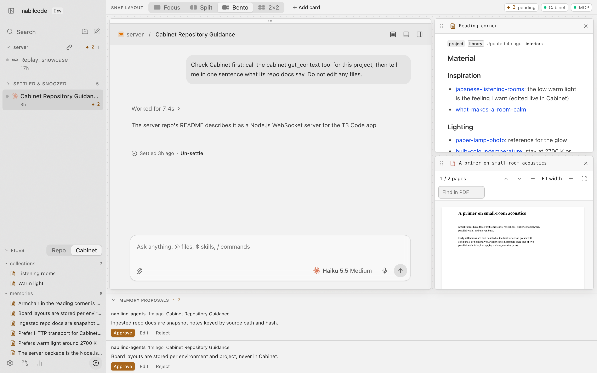
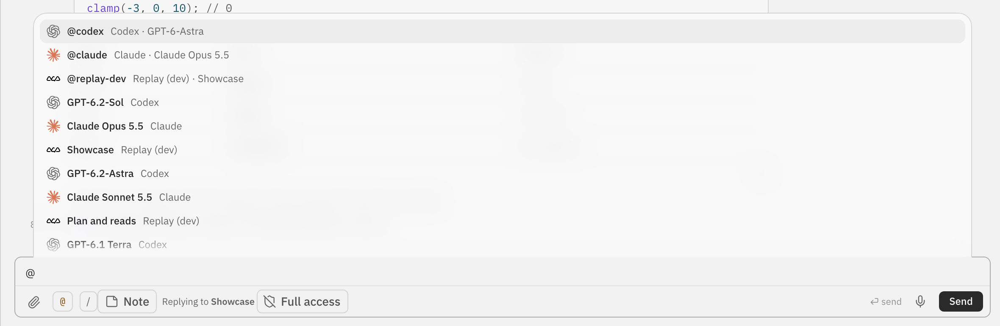
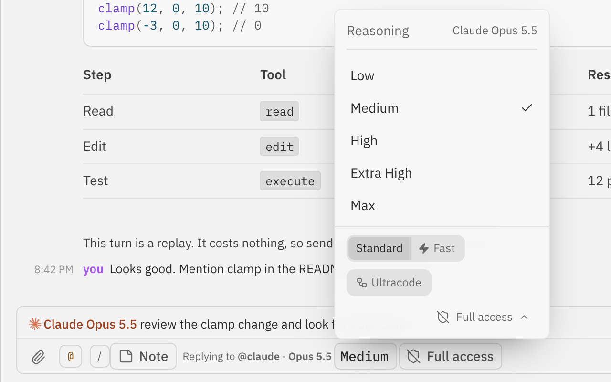
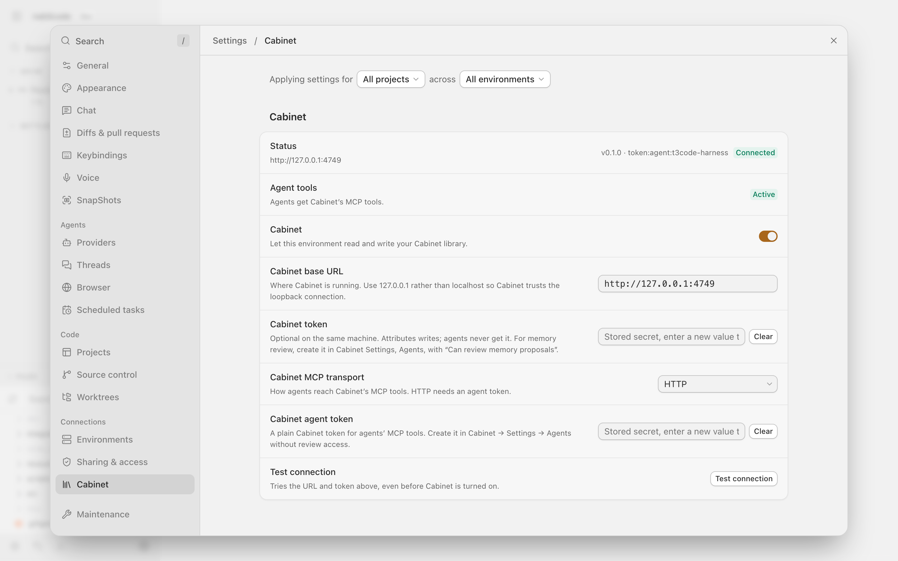
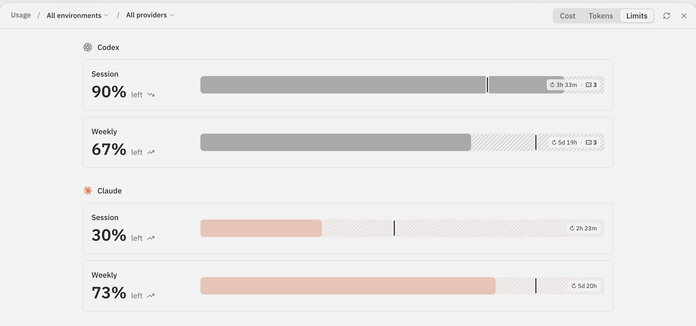

<h1 align="center">kotrai</h1>
<p align="center"><i>Knights of the Round Table AI</i></p>

<p align="center">One app for all your coding and chat agents: Claude, Codex, Gemini, and open models like DeepSeek, Kimi and Qwen, with channels, a board for your docs, study mode, voice calls, and phone access.</p>

<p align="center">
  
</p>

kotrai runs the agents already on your machine (Claude Code, Codex, Gemini through Antigravity, OpenCode, and other ACP agents) on your own subscriptions. Each project gets `#channels` where you just type: kotrai picks the right agent, or you `@` one, several, or all of them. A board beside the chat holds the project's notes, PDFs, and diffs, and you can reach all of it from your phone or by voice.

> **Credits.** kotrai is a fork of [nabilcode](https://github.com/latrael/nabilcode) by Nabil (latrael), itself a fork of [T3 Code](https://github.com/pingdotgg/t3code). Thank you, Nabil, for the app and its style.

## What kotrai adds

**No `@` needed, and one click to switch.** A message without an `@mention` goes to an agent picked from what it says: code to Codex, research to Gemini, and anything else to the channel's last agent, or Claude Opus in a new channel. Click **Replying to …** next to send to keep a chat on any model you choose, ask **Everyone** (they discuss and Claude sums up), or call the **Team** (each agent weighs in from its role, then Claude writes the next steps with owners and starts them). The **Note** toggle posts a message without running any agent. [Automatic agent routing](./docs/user/kotrai.md#automatic-agent-routing)

**Full force, with skills.** Claude Opus leads and hands research, code, and review to other agents in parallel through the `delegate_task` tool. A short "Full force" section in `~/.claude/CLAUDE.md` sets the rules: which plan carries most of the work, paid plans before open models, at most three helpers at once, and a task that hits a usage limit goes to another agent. Agents also get coding skills (systematic debugging, test-first coding, code review, checking work before calling it done), and the lead names the right one for each job. [Full force](./docs/user/kotrai.md#full-force)

**Several agents, one message.** `@claude @codex review this` or `@all` sends to each agent in turn as one message, and later agents see the earlier answers.

**Voice calls.** On a phone, the browser version opens straight into a full-screen call screen; on the desktop, the phone button in the composer starts a hands-free call: talk, then pause or tap **Done talking**, and the agent answers out loud. The people button starts a **council call** where every agent answers in its own voice. The call screen shows agent bubbles that light up as each one speaks, a live "What they're doing" feed, and a chat picker that searches every project. [Voice calls](./docs/user/voice-input.md#voice-calls)

**Phone access.** Pair the official T3 Code app, or add the browser version to your home screen, over Tailscale. The browser version has routing and voice calls, and its HTTPS route lets the phone use the microphone. [Phone access](./docs/user/kotrai.md#phone-access)

**Open models.** Add OpenCode from the ACP Registry with an OpenRouter key to use DeepSeek, Kimi, Qwen, GLM, MiniMax, and more. [Open models through OpenCode](./docs/user/kotrai.md#open-models-through-opencode)

**Usage that makes sense.** The Usage page opens on **Plan left**, how much of each subscription remains. The API-equivalent figure is labeled **API value**, an estimate rather than a bill. [Usage and limits](./docs/user/usage.md)

**A real Mac app.** Build a DMG, drag **kotrai** into Applications, and start it at login. [Install as a Mac app](./docs/user/kotrai.md#install-as-a-mac-app)

**Bring your history.** Turn Claude, ChatGPT, and Gemini exports into Markdown folders you can open as a project. [Import chat history](./docs/user/kotrai.md#import-chat-history)

**Study mode.** Agents can draw multiple-choice quizzes and flashcards right in the thread ("make 10 MCQs from this PDF").

**Scheduled tasks.** Run a prompt on a schedule from **Settings → Scheduled tasks**, or ask an agent to set one up. [Scheduled tasks](./docs/user/kotrai.md#scheduled-tasks)

Also: a seagreen theme, Claude in Chrome on by default, and a native arm64/x64 install fix for Macs running Terminal under Rosetta.

## Quick start

1. **Install.** Install [Vite+](https://viteplus.dev) and Rust from [rustup.rs](https://rustup.rs), then build and install the Mac app:

   ```bash
   curl -fsSL https://vite.plus | bash
   vp i
   vp run dist:desktop:dmg:arm64
   ```

   Open the DMG in `release/` and drag **kotrai.app** into **Applications**. Details, Intel Macs, and login items: [Install as a Mac app](./docs/user/kotrai.md#install-as-a-mac-app).

2. **Sign in to your agents.** kotrai uses the CLIs you are signed in to: `claude auth login` for Claude Code, `codex login` for Codex, and the `agy` CLI for Gemini through Antigravity. Check them in **Settings → Providers**, and add [OpenCode](./docs/user/kotrai.md#open-models-through-opencode) for open models.

3. **Set up your phone.** Join the Mac and phone to the same Tailscale tailnet, publish kotrai over HTTPS, and pair:

   ```bash
   tailscale serve --bg --https=443 http://127.0.0.1:3773
   node apps/server/src/bin.ts pair --ttl 60m
   ```

   Open the pairing link on the phone with its address changed to your Mac's `https://<machine>.<tailnet>.ts.net`, then add it to the home screen. For the official T3 Code app instead, see [Phone access](./docs/user/kotrai.md#phone-access).

## How it works

The Mac runs the kotrai server, which owns your projects, threads, and agent sessions. The desktop app, browser tabs, and phones are clients that connect to it over WebSocket, so a conversation started on one shows up on all of them. Agents run on the Mac as their own CLIs (Claude Code, Codex, Antigravity, OpenCode), signed in to your own plans. Tailscale carries the connection when you're away from the Mac.

## From nabilcode

kotrai keeps everything nabilcode built on top of T3 Code:

### Channels

- **`#channels` per project.** Each project in the sidebar holds its channels. **General** channels sit outside any project for everything else.
- **`@` any agent.** `@claude`, `@codex`, `@gemini` (or `@antigravity`), `@grok`, or `@kiro` runs that agent with the channel as context. You can also pick a specific model from the `@` menu. Without an `@`, kotrai [picks the agent for you](./docs/user/kotrai.md#automatic-agent-routing). Every reply shows which agent wrote it.
- **Keep talking to the last agent.** Plain follow-ups go to the channel's last agent with the same model and effort. The composer says who you're replying to. Press **Note** to post notes without running an agent, and press it again to go back.
- **Effort per mention.** When you `@` a model, its reasoning control (Low to Max, plus Fast where the model supports it) appears in the composer for that message.
- **Notes stay in order.** Notes and agent turns appear in the order you posted them.
- **Clean out a channel.** **Clean out** clears the history and ends the agent session but keeps the channel, so you can start fresh without making a new one.
- **Settle what's done.** A finished channel shows a one-click **Settle**, and **Un-settle** brings it back. Auto-settle is off by default. When you turn it on, it never hides a channel with a result you haven't read.

<p align="center">
  
  
</p>

### The board

- **A bento board per project.** Pick Focus, Split, Bento (8+4), or 2×2. Drag cards between slots and drag an edge to resize; widths snap to a 12-column grid. Each project keeps its own layout.
- **Thread cards.** The live channel is the main card. Open other channels beside it, then click **Focus** to swap one into the main card.
- **Split screen across projects.** **Add card → Thread from another project** puts a chat from any project on the board, labeled with its project and ready to reply in. **Split across projects** switches to 2×2 and fills the empty slots with the latest chats of your three most recently active other projects.
- **Notes, documents, and diffs as cards.** In the Files drawer, open Markdown, PDFs, and HTML pages from the repo, or notes and PDFs from Cabinet. PDF and HTML previews are read-only, and HTML pages can load relative assets in their folder and subfolders. Use **Open document…** in the command palette to search your home folder or paste a path. Diff cards show a thread's full diff.
- **Links in chat open on the board.** Clicking a Markdown, PDF, or HTML link in a message opens it as a card. The board moves from Focus to Split to Bento as you open more, and back again as you close them.
- **Edit Markdown in place.** Click **Edit** on a note card and write in its formatting (**Rich**) or as raw Markdown (**Text**). Press ⌘S to save back to Cabinet or the repo. If the note changed in Cabinet while you were editing, you choose whether to reload or overwrite.
- **Quote from PDFs.** Select text and choose **Cite to thread** to attach it to your next message, or **Save quote to Cabinet** to keep it.
- **Terminals in the sidebar.** A project's **New terminal** button opens a shell in its root or in one of its worktrees. Each terminal has its own row, so you can leave it and come back. The shell keeps running while you're away.

### Cabinet

- **Cabinet notes that stay in sync.** `[[wikilinks]]` open the linked note. Ticking a checklist box saves it to Cabinet. Edits made in Cabinet appear in the open card.
- **`@` mentions for Cabinet.** Type `@` in the composer to mention a Cabinet note. The agent gets its id and fetches the full note with Cabinet's tools.
- **Agents that know your project.** **Ingest into Cabinet** links a repo to a Cabinet project and copies its README, AGENTS.md, CLAUDE.md, and `docs/` into Cabinet as notes. Agents then get Cabinet's MCP tools and a short project brief on their first turn.
- **Memory proposals.** When an agent wants Cabinet to remember something, it proposes it instead of writing it. Approve, edit, or reject proposals in the dock under the board. Badges show which channels and projects have proposals waiting.

<p align="center">
  
</p>

### Agents and usage

- **Your subscriptions.** kotrai drives the agents you are already signed in to. It does not resell tokens.
- **Limits at a glance.** **Usage → Plan left** shows session and weekly quota, with reset times, for Codex, Claude, and Antigravity. Antigravity's limits come from the `agy` CLI's own sign-in in your system keychain, so macOS asks for permission the first time.
- **Antigravity subagents.** Antigravity's subagent activity streams into the channel, nested under the step that started it.
- **Bring your history.** The Welcome page imports Claude Code and Codex history, and Antigravity conversations started in Zed. Imported Antigravity threads continue with their full context.
- **Private by default.** Usage telemetry is off unless you set `T3CODE_TELEMETRY_ENABLED=true`.

<p align="center">
  
</p>

## Develop

To work on kotrai itself, run it from source.

### 1. Install the toolchain

kotrai uses [Vite+](https://viteplus.dev). Install its `vp` command, then install dependencies from the repository root:

```bash
curl -fsSL https://vite.plus | bash
```

```bash
vp i
```

If your shell can't find `vp` (nvm can reorder `PATH`), call it directly as `~/.local/share/vite-plus/bin/vp`.

You also need at least one agent installed and signed in, for example `claude auth login` for Claude Code, `codex login` for Codex, or signing in to the `agy` CLI for Antigravity.

### 2. Start the app

To run the desktop app:

```bash
vp run dev:desktop
```

To run the server and the web app instead:

```bash
vp run dev
```

Open the **pairing URL** the dev runner prints. The bare address alone won't sign a new browser in.

If another process already uses the default ports (5733 and 13773), shift them:

```bash
T3CODE_PORT_OFFSET=200 vp run dev:desktop
```

Dev state lives in `~/.t3/dev`, separate from any installed copy.

### 3. Connect Cabinet

Start Cabinet from its own repository. Use a sandbox library while you try things out:

```bash
pnpm cabinet init ~/Cabinet-Sandbox --sample
```

```bash
pnpm cabinet start --library ~/Cabinet-Sandbox
```

In Cabinet, under **Settings → Agents**, create two tokens:

- a **harness token** with **Can review memory proposals** turned on. kotrai uses it for reading, writing, and reviewing proposals. Agents never receive it.
- a plain **agent token**. Agents use it for Cabinet's MCP tools.

Then in kotrai, go to **Settings → Cabinet**. Turn Cabinet on, set the base URL (use `http://127.0.0.1:4747` rather than `localhost`), and paste both tokens. The status should read **Connected**, and **Agent tools** should read **Active**.

### 4. Try it

1. In the sidebar, hover a project and choose **New channel**.
2. Press **Note** and write down your plan, then press **Note** again and ask for the work, or `@claude` (or another agent) to pick one.
3. Keep replying to the same agent, or press **Note** to jot something down without running it.
4. Hover the project and choose **Ingest into Cabinet**, then switch the Files drawer to **Cabinet** to open notes and PDFs as cards.
5. Review anything the agent proposes in the **Memory Proposals** dock.

To watch a turn without paying for a model, `@replay-dev` in a channel. It replays recorded turns through the real pipeline for free.

## Checks

```bash
vp run check:changed
```

This runs format, lint, knip, typecheck, and the tests next to your changes. For a single file, run `vp test run <file>`. Browser tests need Playwright's Chromium once:

```bash
cd apps/web && vp exec playwright install chromium
```

## License

[MIT](./LICENSE). kotrai is forked from [nabilcode](https://github.com/latrael/nabilcode) by Nabil (latrael), itself forked from [T3 Code](https://github.com/pingdotgg/t3code) by T3 Tools.
